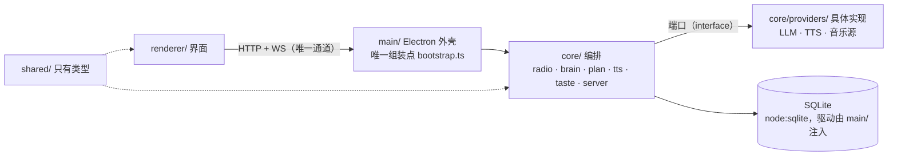

# EdgeRunner · AI Music Radio

一个**本地常驻的个人 AI 电台**：打开就在放，DJ 用英文讲一两句，把歌串成一条不断的流。
随时插一句话（"来点能专注的"），它当场调头。


[](https://github.com/xshouter/edgerunner/actions/workflows/ci.yml)
[](https://github.com/xshouter/edgerunner/releases)

## 它是什么

- 打开就是一个电台，不用点"播放"。口号：**一开机我就打碟**。
- DJ 每天排一次节目表，按时段换 mood（清晨 / 白天 / 深夜）。
- 换歌之间，DJ 会用**英文**说一两句 —— 为什么放这首、接下来往哪走。
- 可以随时插话（`POST /api/chat`："something slow for focus"），DJ 当场改队列。
- 队列面板上的 `♡` 是"我的口味"：点一下，系统就记一条；`FAV` 面板就地换成喜欢列表。
- 双主题（DARK / LIGHT），整块界面按固定比例等比缩放。

单用户、单机（PC）、无账号体系。

## 下载并运行

去 [Releases](https://github.com/xshouter/edgerunner/releases) 下 `EdgeRunner-x.y.z-portable.exe`，双击就能跑 —— **只有便携版，没有安装包**。

**exe 里不含任何凭证。** 第一次打开**不哑**：它会放一首随包的示例曲目（`assets/demo/`），
并说一段出厂时录好的口播，界面上是一条 **SET UP** 引导，教你把钥匙填进去 ——
填完立刻换成一台真正属于你的电台。

## 填上你自己的钥匙

在界面右上角点 **LOGIN**，弹窗里填。三类，都只存在你自己机器的用户数据目录里：

| 要什么 | 从哪来 | 不填会怎样 |
|---|---|---|
| **LLM key**（任何 OpenAI 或 Anthropic 兼容的） | 默认指阿里云百炼的 OpenAI 兼容端点；`llm.baseUrl` / `llm.model` / `llm.protocol` 都可改 | 不排你自己的节目表：开机放随包的示例曲目 + 出厂口播，界面给一条 `SET UP` 引导 |
| **口播语音**（Piper，离线） | **不用填** —— 本地音色，`npm run fetch:voice` 装一次 | 口播只剩文字，没有声音（`TTS_FAILED` 有兜底文案，不中断） |
| **网易云 cookie** | 浏览器登录 music.163.com 后整条 Cookie 头 | 音乐源退到本地目录 |

## 音乐源

网易云的 web 接口要过一层请求加密，而这层**不在内核里** —— 它由一个 NeteaseCloudMusicApi
**兼容服务**承担。那份服务**跟着 exe 一起发**：开机时由内核自己拉起来（挑一个空闲端口，**不碰 3000**）、
退出时收掉 —— **双击就能听，你不用再起第二个进程。**

想接自己的实现（自己那份服务，或者别的兼容服务）时用环境变量覆盖，给了它内核就不代管：

```powershell
$env:EDGERUNNER_NETEASE_BASE_URL = "http://127.0.0.1:3000"; & ".\EdgeRunner-x.y.z-portable.exe"
```

**它没起来也能用 —— 但前提是本地目录里真有歌。** 降级链退到**本地音乐目录**（界面上出现降级标记）：
把 mp3 丢进 `%APPDATA%\edgerunner\music\` 就有歌可放 —— 这条降级链是设计的一部分，不是兜底补丁。

反过来，**服务起不来、本地目录又是空的**：音乐源一首也拿不出来，大脑就没有可排的曲目，
电台会停在 `OFF AIR`。这种情况下界面会明确报 `MUSIC_SOURCE_UNREACHABLE`：

> The music source is not answering. Only what is cached locally can play.

看到这一句先看日志里的 `[netease]` 那几行（它会把服务自己吐的最后几个字带上）—— **它说的不是你的 key 有问题**。

## 数据存在哪

全部在本机：

```
%APPDATA%\edgerunner\
  data\edgerunner.sqlite   # 设置（key / cookie）、播放事实、历史、日表、口味结论
  data\taste\              # 语料：你自己写的 .md；系统的结论只写库，永不回写语料
  music\                   # 本地音乐兜底目录
  tts\                     # 离线音色运行时与模型
  logs\edgerunner.log      # 现场日志：双击之后出了什么事，事后要能读出来
```

## 架构



依赖方向单向向下：`renderer/` 只认 `shared/` 的类型；`core/` 不认识 Electron，也不认识具体的 SQLite 驱动；
**具体实现只在 `main/bootstrap.ts` 被 `new` 出来**。

| 路径 | 是什么 |
|---|---|
| `shared/` | 前后端唯一真相：只有类型，零运行时依赖 |
| `core/` | 内核：编排 + 端口 + 具体实现（不认识 Electron） |
| `main/` | 唯一组装点 + Electron 外壳 + 令牌桥 |
| `renderer/` | 界面（Vite + React 19 + TS） |
| `mock/` | 零依赖假后端：UI 对着它开发 |
| `tools/check-boundaries.mjs` | 渲染进程不许碰数据库 / 存储 / node 内建的机械检查 |

## 开发

```bash
npm install

npm run mock          # 零依赖假后端 → http://127.0.0.1:8765
npm run dev           # 界面（vite）→ http://localhost:5173，/api 代理到 mock

npm run boundaries    # 依赖边界检查
npm run typecheck     # shared / core / main / renderer 四处
npm test              # 内核 + 外壳的自检
npm run build         # 构建界面

npm run electron:dev  # 本机起壳：打主进程 + 开窗（等价于装了 exe 的效果）
npm run dist          # 出便携 exe → release/
```

出包只从**绿的**树上切（见 `.github/workflows/release.yml`）：

```bash
git tag v0.1.0 && git push origin v0.1.0     # 流水线建一个 draft Release
gh release edit v0.1.0 --draft=false          # 人看过再放出去
```

## 已知边界

- 只做 **PC 单端**；不做歌词。
- 口播是**英文**；声音来自本地 Piper 离线音色（不要 key、音质一般）。
- TTS 响应没有词级时间戳，逐词高亮是按音频总长均分的。
- 发布出去的 exe **不含任何凭证**，所有 key 由使用者自己填写。
- 便携 exe 约 **172 MB** —— 离线 Piper 运行时 + 一把音色模型（`en_GB-alan-medium`，61 MB）随包发，
  换来的是开箱就有声音、不要 key。
- 音乐播放定位为**个人自用**；取流逻辑全部收在 `MusicSource` 端口后面，换成合法音源只需新增一个实现。
- `assets/demo/` 里那一首示例曲目与它那段口播只作首次体验演示用，不含歌词与封面素材。