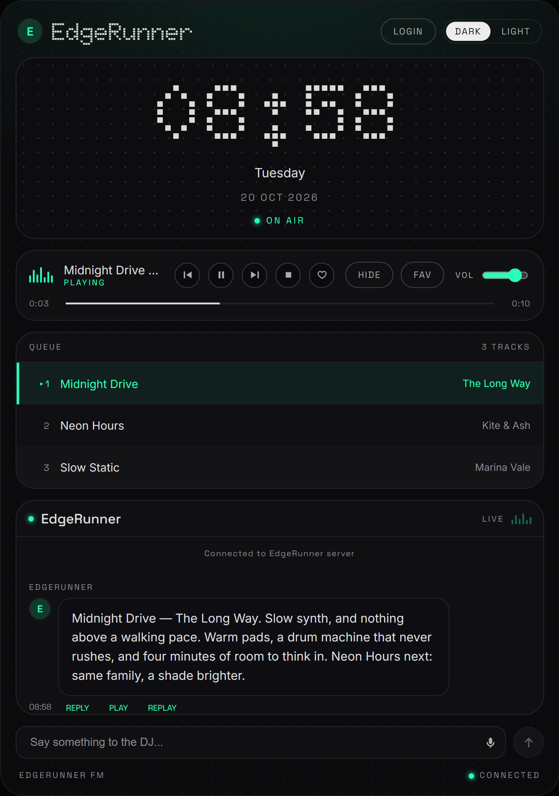
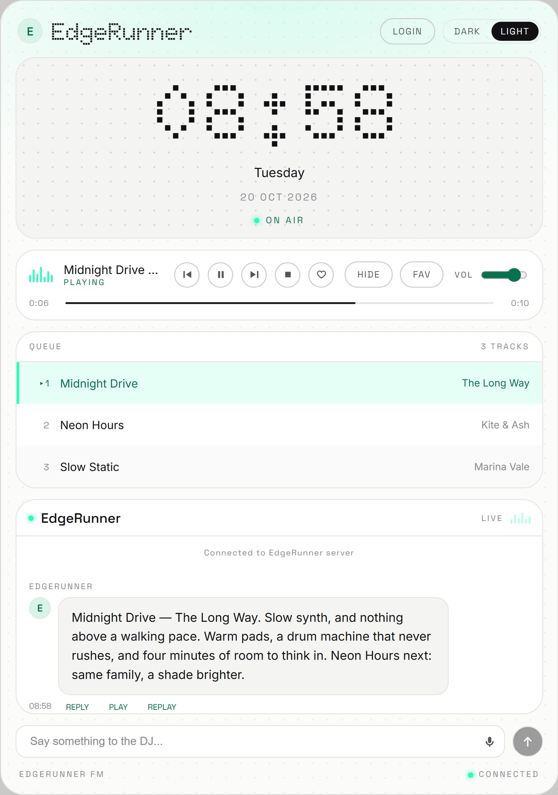

# EdgeRunner · AI Music Radio

**EdgeRunner** 是一台装在你电脑上的个人 AI 电台：打开就在放，DJ 用英文讲一两句，把歌串成一条不断的流。
你随时可以对它说一句话（"来点能专注的"），它当场调头。

**口号：一开机我就打碟。**





[](https://github.com/xshouter/edgerunner/releases)

---

## 它是什么

- **打开就是一个电台**，不用点"播放"。
- **DJ 每天排一次节目表**，按时段换 mood：清晨 / 白天 / 深夜。
- **换歌之间，DJ 会用英文说一两句** —— 为什么放这首、接下来往哪走。
- **可以随时插话**："something slow for focus"，DJ 当场改队列。
- **`♡` 是"我的口味"**：点一下，系统就记一条；`FAV` 面板就地换成喜欢列表。
- **双主题**（DARK / LIGHT），整块界面按固定比例等比缩放。

单用户、单机、无账号体系。

## 界面速览

| 区域 | 是什么 |
|---|---|
| 顶栏 | `LOGIN`（填钥匙）、`DARK` / `LIGHT`（切主题） |
| 大钟 | 当前时间、日期，以及电台状态：`ON AIR` / `OFF AIR` / `DEGRADED` |
| 运输条 | 波形、正在放的曲目、上一首 / 播放·暂停 / 下一首 / 停止、`♡`、`HIDE`、`FAV`、音量 |
| 进度条 | 当前曲目放到哪儿了 |
| 队列 | `QUEUE`（DJ 排的）/ `FAVORITES`（你喜欢的）两个面板，点一行就切到那首 |
| DJ 对话区 | DJ 说的话，以及你插的话；每条下面有 `PLAY` / `REPLAY` 播它的口播 |
| 输入框 | 跟 DJ 说话的地方 |
| 页脚 | 连接状态 |

## 下载并运行

去 [Releases](https://github.com/xshouter/edgerunner/releases) 下载 `EdgeRunner-x.y.z-portable.exe`，双击就能跑。

- **只有便携版，没有安装包**：不写注册表、不装任何东西，删掉 exe 就等于卸载。
- 系统要求：Windows（64 位）。
- 首次启动会稍微慢一点（要把内置的音乐服务拉起来）。

## 第一次启动

**exe 里不含任何凭证，但第一次打开不哑**：它会放一首随包的示例曲目，并说一段出厂时录好的口播。

界面上会有一条 **SET UP** 引导，教你把钥匙填进去。填完立刻换成一台真正属于你的电台 ——
从那一刻起，节目表是你自己的、歌单是你自己的。

## 填上你自己的钥匙

界面右上角点 **LOGIN**，弹窗里填。三类，都只存在你自己机器的用户数据目录里：

| 要什么 | 从哪来 | 不填会怎样 |
|---|---|---|
| **LLM key** | 任何 OpenAI 或 Anthropic 兼容的服务；默认指向阿里云百炼的 OpenAI 兼容端点，base URL、模型名、协议都可以改 | 不排你自己的节目表：开机放随包的示例曲目 + 出厂口播，界面给一条 `SET UP` 引导 |
| **口播语音** | **不用填** —— 离线音色随包自带 | 不会发生：它是随包发的 |
| **网易云 cookie** | 浏览器登录 music.163.com 后，把整条 Cookie 头复制过来 | 音乐源退到本地音乐目录 |

## 音乐源

网易云的 web 接口要过一层请求加密，这层由一个 **NeteaseCloudMusicApi 兼容服务**承担。

**那份服务跟着 exe 一起发。** 启动时由 EdgeRunner 自己拉起来（挑一个空闲端口，不碰 3000），退出时收掉 ——
**双击就能听，你不需要再开第二个进程。**

### 它没起来也能用

前提是本地目录里真有歌。降级链会退到**本地音乐目录**（界面上出现降级标记）：

```
%APPDATA%\edgerunner\music\
```

把 mp3 丢进去就有歌可放。这条降级链是设计的一部分，不是兜底补丁。

### 服务起不来、本地目录又是空的

音乐源一首也拿不出来，DJ 就没有可排的曲目，电台会停在 `OFF AIR`，并明确报 `MUSIC_SOURCE_UNREACHABLE`：

> The music source is not answering. Only what is cached locally can play.

看到这一句，先看日志里的 `[netease]` 那几行（它会把服务自己吐的最后几个字带上）——
**它说的不是你的 key 有问题。**

## 你的数据

全部在本机：

```
%APPDATA%\edgerunner\
  data\edgerunner.sqlite   # 设置（key / cookie）、播放事实、历史、日表、口味结论
  data\taste\              # 语料：你自己写的 .md；系统的结论只写库，永不回写语料
  music\                   # 本地音乐目录
  tts\                     # 离线音色运行时与模型
  logs\edgerunner.log      # 现场日志：出了什么事，事后能读出来
```

想从头来一遍：关掉 EdgeRunner，删掉这个目录即可。发布出去的 exe 从不包含任何凭证。

## 进阶

想换成自己那份音乐服务（或别的兼容服务），用环境变量覆盖内置的那份：

```powershell
$env:EDGERUNNER_NETEASE_BASE_URL = "http://127.0.0.1:3000"; & ".\EdgeRunner-x.y.z-portable.exe"
```

给了它，EdgeRunner 就不再代管内置服务。

## 已知边界

- 只做 **PC 单端**。
- **不做歌词。**
- 口播是**英文**；声音来自随包的离线音色（音质一般，但不要 key、不要联网）。
- 逐词高亮是按音频总长均分的 —— TTS 响应里没有词级时间戳。
- 音乐播放定位为**个人自用**；换成合法音源只需换掉音乐源这一环。
- `assets/demo/` 里那一首示例曲目与它那段口播只作首次体验演示用，不含歌词与封面素材。