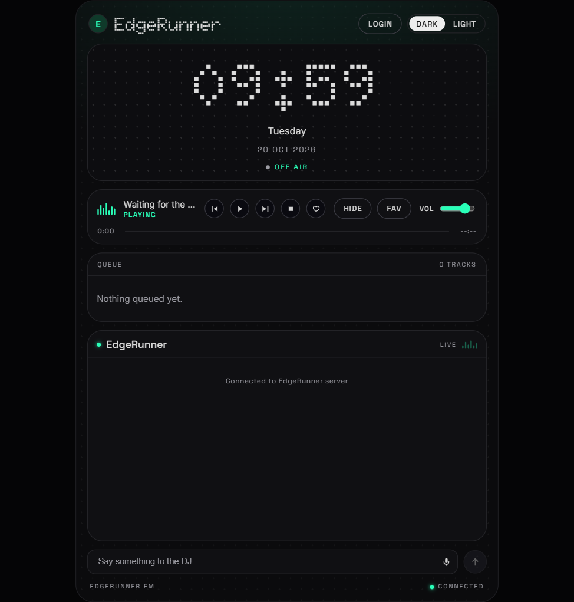
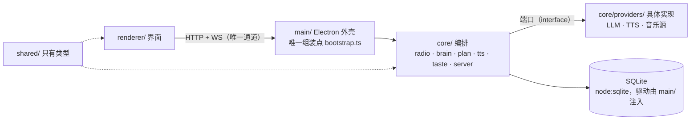
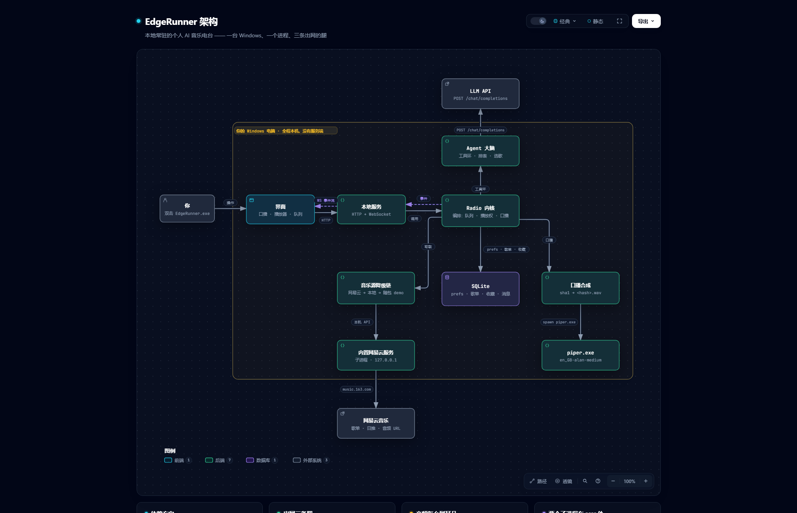

# EdgeRunner · AI Music Radio

**EdgeRunner** 是一个**本地常驻的个人 AI 电台**：打开就在放，DJ 用英文讲一两句，串成一条不断的流。
你可以随时插话（"来点能专注的"），它会当场调头。

界面形状复刻自 [Claudio x mmguo FM](https://mmguo.dev/claudio-fm/)，**代码从零写**（见 `docs/references.md`）。



[](https://github.com/xshouter/edgerunner/actions/workflows/ci.yml)
[](https://github.com/xshouter/edgerunner/releases)

> **这是一个求职作品集项目。** 它不只要"能跑"——它被当作一次完整的产品交付来推进：
> 每个架构决策都有 ADR，每次改动都有 PR 与四段式说明（背景 / 困难 / 决策 / 证据），**困难不许空着**。
> 读这个仓库的正确方式是读 `docs/`，而不是先读代码。

## 它是什么

- 打开就是一个电台，不用点"播放"。口号：**一开机我就打碟**。
- DJ 每天排一次节目表，按时段换 mood（清晨 / 白天 / 深夜）。
- 换歌之间，DJ 会用**英文**说一两句——为什么放这首、接下来往哪走。
- 可以随时插话（`POST /api/chat`："something slow for focus"），DJ 当场改队列。
- `♡` 是"我的口味"：点一下，系统就记一条"学到的"；`FAV` 面板就地换成喜欢列表。
- 双主题（DARK / LIGHT），整块界面按固定比例等比缩放。

只服务作者一个人：**单用户、单机（PC）、无账号体系**。

## 下载并运行

去 [Releases](https://github.com/xshouter/edgerunner/releases) 下 `EdgeRunner-x.y.z-portable.exe`，双击就能跑 —— **只有便携版，没有安装包**（ADR-0023）。

**exe 里不含任何凭证。** 第一次打开**不哑**：它会放一首随包的 demo 唱片（Harry Styles — *Sign of the Times*），
并说一段出厂时录好的口播，界面上是一条 **SET UP** 引导（[ADR-0033](docs/adr/0033-first-run-demo.md)）。
这一节教你把钥匙填进去 —— 填完立刻换成一台真正属于你的电台。

## 填上你自己的钥匙

在界面右上角点 **LOGIN**，弹窗里填。三类，都只存在你自己机器的用户数据目录里：

| 要什么 | 从哪来 | 不填会怎样 |
|---|---|---|
| **LLM key**（任何 OpenAI 或 Anthropic 兼容的） | 默认指阿里云百炼的 OpenAI 兼容端点（`llm.baseUrl` + `llm.model` 可改，`llm.protocol` 切 openai/anthropic） | 不排你自己的节目表：开机放的是随包的 demo 唱片 + 一段出厂口播，界面给一条 `SET UP` 引导 |
| **口播语音**（Piper，离线，[ADR-0022](docs/adr/0022-tts-piper-offline.md)） | **不用填** —— 本地音色，`npm run fetch:voice` 装一次 | 口播只剩文字，没有声音（`TTS_FAILED` 有兜底文案，不中断） |
| **网易云 cookie**（ADR-0011） | 浏览器登录 music.163.com 后整条 Cookie 头 | 音乐源退到本地目录 |

**音乐源现在是内置的（[ADR-0028](docs/adr/0028-bundled-music-service.md)）：** 网易云的 web 接口要过一层请求加密，而这层**不在内核里**
（ADR-0016）——它由一个 NeteaseCloudMusicApi **兼容服务**承担。从这一版起，那份服务**跟着 exe 一起发**：
开机时由内核自己拉起来（挑一个空闲端口，**不碰 3000**）、退出时收掉 —— **双击就能听，你不用再起第二个进程。**
想接自己的实现（自己那份服务，或者别的兼容服务）时用环境变量覆盖，给了它内核就不代管：

```powershell
$env:EDGERUNNER_NETEASE_BASE_URL = "http://127.0.0.1:3000"; & ".\EdgeRunner-x.y.z-portable.exe"
```

**它没起来也能用 —— 但前提是本地目录里真有歌。** 降级链退到**本地音乐目录**（界面上出现降级标记）：
把 mp3 丢进 `%APPDATA%\EdgeRunner\music\` 就有歌可放 —— 这条降级链是设计的一部分，不是兜底补丁。

反过来，**服务起不来、本地目录又是空的**：音乐源一首也拿不出来，大脑就没有可排的曲目，
电台会停在 `OFF AIR`。这种情况下界面会明确报 `MUSIC_SOURCE_UNREACHABLE`：

> The music source is not answering. Only what is cached locally can play.

看到这一句先看日志里的 `[netease]` 那几行（它会把服务自己吐的最后几个字带上）—— **它说的不是你的 key 有问题**（ADR-0027）。

**数据存在哪**（全部在本机，不进仓库）：

```
%APPDATA%\EdgeRunner\
  data\edgerunner.sqlite   # 设置（key/cookie）、播放事实、历史、日表、口味结论
  data\taste\              # 语料：你自己写的 .md；系统的结论只写库，永不回写（ADR-0004）
  music\                   # 本地音乐兜底目录
```

## 进展

| 阶段 | 状态 |
|---|---|
| 抽象层设计 + 五条铁律 | ✅ 已合并（PR #3） |
| 冻结抽象层（ADR-0001…0007） | ✅ 已合并（PR #4、#5） |
| 契约 + mock | ✅ 已合并（PR #8） |
| UI 复刻（双主题、口播全屏态、队列/FAV、DJ 详情、LOGIN） | ✅ 已合并（阶段 3） |
| 真后端（Store / Brain / 音乐降级链 / TTS / 调度器 / 语料） | ✅ 已合并（阶段 4） |
| Electron 外壳 | ✅ 已合并（阶段 5.1，PR #31） |
| Release 流水线（打 tag 出便携 exe；`v0.1.0` 已发布） | ✅ 已合并（PR #32、#34） |
| 语音引擎（离线 Piper）+ 只发便携版 + 应用图标 | ✅ 已合并（阶段 5.4，PR #38） |
| 口播：连续化 + 逐首挂起 + 音色换成低沉有磁性的男声 | ✅ 已合并（PR #45、#46、#49、#51） |
| 开机：歌单读成口味画像 → 日表 → 开场口播 | ✅ 已合并（PR #47、#48） |
| 窗口与界面细节（等比缩小 / 圆角 / 环境光 / 进度条真实性） | ✅ 已合并（PR #41、#42、#44） |
| 内置音乐源：打开即用，内核代管启动 | ✅ 已合并（PR #54） |
| 口播归位：一首歌一条、答话不进广播、播放权离开界面 | ✅ 已合并（PR #55） |
| 日表从日推来：排表走同一套工具环，换一个终局工具 | ✅ 已合并（PR #56） |
| 真数据端到端：日推那条路的第一次实跑，以及它露出的缝 | ✅ 已合并（PR #57） |
| 池子优先：排表拆两段，第一段只给池子、第二段才放开搜索 | ✅ 已合并（PR #59） |
| 开机进度：窗口先出生，排表在界面里跑，不再黑屏十几秒 | ✅ 已合并（PR #60） |
| 错误码说真话（源不可达 / key 被拒 / 限流各报各的，开场失败也看得见） | ✅ 已合并（PR #53） |
| 首次体验：没填 key 的开机也有歌、有口播、有引导（随包 demo 唱片） | ✅ 已合并（PR #61） |

拆解与逐 PR 的推进记录见 `docs/roadmap.md` 与 `docs/journal/`。

## 架构



依赖方向单向向下：`renderer/` 只认 `shared/` 的类型；`core/` 不认识 Electron，也不认识具体的 SQLite 驱动；
**具体实现只在 `main/bootstrap.ts` 被 `new` 出来**。

完整定义（端口签名、数据与 API 契约、降级语义、测试切入点）见 `docs/abstraction-layer.md`。

### 一张能点的图



同一件事的**图版**：12 个语义节点、13 条关系，含动效、搜索，以及「任意两个节点之间怎么走」的路径追踪。
源（`candidate.json`，**每个组件都钉着仓库里的行号**）、静态图与重渲染命令见 [`docs/architecture/`](docs/architecture/)。

## 工程纪律

五条铁律写在 `AGENTS.md`，落地细则与"被违反的样子"在 `docs/engineering-rules.md`：

1. **代码用 git 管理** —— 分支 → PR → 自查 → 合并，不直推 `main`
2. **需求必须 grill** —— 没被追问到没有隐含假设的需求，不许写代码
3. **先前端再后端** —— 冻结契约 → mock → UI → 换真后端
4. **好看优先，自己拍板** —— 视觉不明确时自己定（可用 skill / 搜索 / 线上真源），不要停下等确认
5. **前端永远不碰数据库** —— `renderer/` 只能通过 HTTP/WS 说话

其中第 1、5 条由机器而不是靠自觉保证：PR 模板强制四段正文，
`tools/check-boundaries.mjs` 在 CI 里扫越界的 import 与 SQL 特征串（`renderer/` / `core/` / `main/` / `shared/` 四层）。

## 目录导览

| 路径 | 是什么 |
|---|---|
| `docs/abstraction-layer.md` | 系统的"缝"：分层、端口、契约、降级语义 |
| `docs/architecture/` | 架构图：可验证的源 + 静态图 + 重渲染命令 |
| `docs/roadmap.md` | 分阶段、按 PR 拆解的推进计划 |
| `docs/requirements/` | 每个功能"被要求做什么"（铁律 2 的产出） |
| `docs/adr/` | 架构决策记录（含模板） |
| `docs/journal/` | 开发日志：踩到的坑与当时的判断 |
| `docs/references.md` | 参考源、与原型的差异、版权边界 |
| `docs/engineering-rules.md` | 五条铁律的落地细则 |
| `AGENTS.md` | 五条铁律正文 |
| `shared/` | 前后端唯一真相：只有类型，零运行时依赖 |
| `core/` | 内核：编排 + 端口 + 具体实现（不认识 Electron） |
| `main/` | 唯一组装点 + Electron 外壳 + 令牌桥 |
| `renderer/` | 界面（Vite + React 19 + TS） |
| `mock/` | 零依赖假后端：UI 对着它开发 |
| `tools/check-boundaries.mjs` | 铁律 5 的机械检查 |

## 开发

```bash
npm install

npm run mock          # 零依赖假后端 → http://127.0.0.1:8765
npm run dev           # 界面（vite）→ http://localhost:5173，/api 代理到 mock

npm run boundaries    # 铁律 5 的机械检查
npm run typecheck     # shared / core / main / renderer 四处
npm test              # 内核 + 外壳的自检
npm run build         # 构建界面

npm run electron:dev  # 本机起壳：打主进程 + 开窗（等价于装了 exe 的效果）
npm run dist          # 出便携 exe → release/
```

出包只从**绿的**树上切（见 `.github/workflows/release.yml`）：

```bash
git tag v0.1.0 && git push origin v0.1.0     # 流水线建一个 draft Release
gh release edit v0.1.0 --draft=false          # 人看过再放出去
```

## 诚实声明

- 与原型作者 mmguo **无关**，不使用其任何代码或素材；仓库内只随包带一首 demo 唱片与它那段口播（`assets/demo/`，仅个人演示，ADR-0033），不含歌词与封面素材。
- 音乐播放定位为**个人自用**；取流逻辑全部收在 `MusicSource` 端口后面，换成合法音源只需新增一个实现。
- 发布出去的 exe **不包含任何凭证**，所有 key 由使用者自己填写。
- 便携 exe 约 **172 MB** —— 离线 Piper 运行时 + 一把音色模型（`en_GB-alan-medium`，61 MB）随包发，
  换来的是**开箱就有声音、不要 key**；再加上随包的 demo 唱片与它那段口播（约 3 MB，ADR-0033）。
  合上喉咙的钱是明码的：这是包里最大的一块。
- **已知边界（不藏）**：只做 PC 单端；不做歌词；网易云要一个外部兼容服务（上上节）；
  口播是英文，声音来自**本地 Piper 离线音色**（不要 key、音质一般，[ADR-0022](docs/adr/0022-tts-piper-offline.md)）；TTS 响应没有词级时间戳，逐词高亮是按音频总长均分的（ADR-0017）。