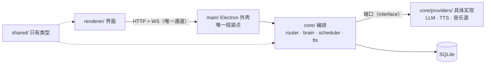

# EdgeRunner · AI Music Radio

**EdgeRunner** 是一个**本地常驻的个人 AI 电台**：它自己排当天的节目、自己挑歌、用英文开口讲一两句，
然后把歌和话串成一条不断的流。

交互形状复刻自 [Claudio x mmguo FM](https://mmguo.dev/claudio-fm/)，**代码从零写**（见 `docs/references.md`）。

> **这是一个求职作品集项目。** 它不只要"能跑"——它被当作一次完整的产品交付来推进：
> 每个架构决策都有 ADR，每次改动都有 PR 与四段式说明（背景 / 困难 / 决策 / 证据），**困难不许空着**。
> 读这个仓库的正确方式是读 `docs/`，而不是先读代码。

## 它是什么

- 打开就是一个电台，不用点"播放"。
- DJ 每天排一次节目表，按时段换 mood（清晨 / 白天 / 深夜）。
- 换歌之间，DJ 会用英文说一两句——为什么放这首、接下来往哪走。
- 可以随时插话（`POST /api/chat`："来点能专注的"），DJ 会当场调头。
- 歌词逐行跟着走。

只服务作者一个人：单用户、单机、无账号体系。

## 进展

| 阶段 | 状态 |
|---|---|
| 抽象层设计 + 五条铁律 | ✅ 已合并 |
| 仓库地基（PR 模板 / ADR 模板 / 边界检查 + CI / 日志） | ✅ 已合并（PR #3） |
| 冻结抽象层（ADR-0001…0007，含「只做 PC 单端」的范围修正） | ✅ 已合并（PR #4、#5） |
| 契约 + mock | — |
| UI 复刻（宽窗大钟态 / 窄窗卡片态） | — |
| 真后端（Store / Brain / 音乐降级链 / TTS / 调度器） | — |
| Electron 打包 + Release | — |

拆解见 `docs/roadmap.md`。**UI 复刻是这个项目的重心**——它决定这个项目有没有"taste"。

## 架构

依赖方向单向向下：`renderer/` 只认 `shared/` 的类型；`core/` 不认识 Electron；
**具体实现只在 `main/bootstrap.ts` 被 `new` 出来**。
完整定义（端口签名、数据与 API 契约、降级语义、测试切入点）见 `docs/abstraction-layer.md`。

## 工程纪律

五条铁律写在 `AGENTS.md`，落地细则与"被违反的样子"在 `docs/engineering-rules.md`：

1. **代码用 git 管理** —— 分支 → PR → 自查 → 合并，不直推 `main`
2. **需求必须 grill** —— 没被追问到没有隐含假设的需求，不许写代码
3. **先前端再后端** —— 冻结契约 → mock → UI → 换真后端
4. **样式不明确就要截图** —— 不猜颜色、间距、动效
5. **前端永远不碰数据库** —— `renderer/` 只能通过 HTTP/WS 说话

其中第 1、5 条由机器而不是靠自觉保证：PR 模板强制四段正文，
`tools/check-boundaries.mjs` 在 CI 里扫越界的 import 与 SQL 特征串。

## 目录导览

| 路径 | 是什么 |
|---|---|
| `docs/abstraction-layer.md` | 系统的"缝"：分层、端口、契约、降级语义 |
| `docs/roadmap.md` | 分阶段、按 PR 拆解的推进计划 |
| `docs/adr/` | 架构决策记录（含模板） |
| `docs/journal/` | 开发日志：踩到的坑与当时的判断 |
| `docs/references.md` | 参考源、与原型的差异、版权边界 |
| `docs/engineering-rules.md` | 五条铁律的落地细则 |
| `AGENTS.md` | 五条铁律正文 |
| `tools/check-boundaries.mjs` | 铁律 5 的机械检查 |

## 怎么跑

还没到那一步。第一个可运行版本随 UI 复刻那个 PR 落地，届时这里会写清**怎么填自己的 API key**。

## 诚实声明

- 与原型作者 mmguo **无关**，不使用其任何代码或素材；仓库内不含音频、歌词、封面素材。
- 音乐播放定位为**个人自用**；取流逻辑全部收在 `MusicSource` 端口后面，换成合法音源只需新增一个实现。
- 发布出去的 exe **不包含任何凭证**，所有 key 由使用者自己填写。