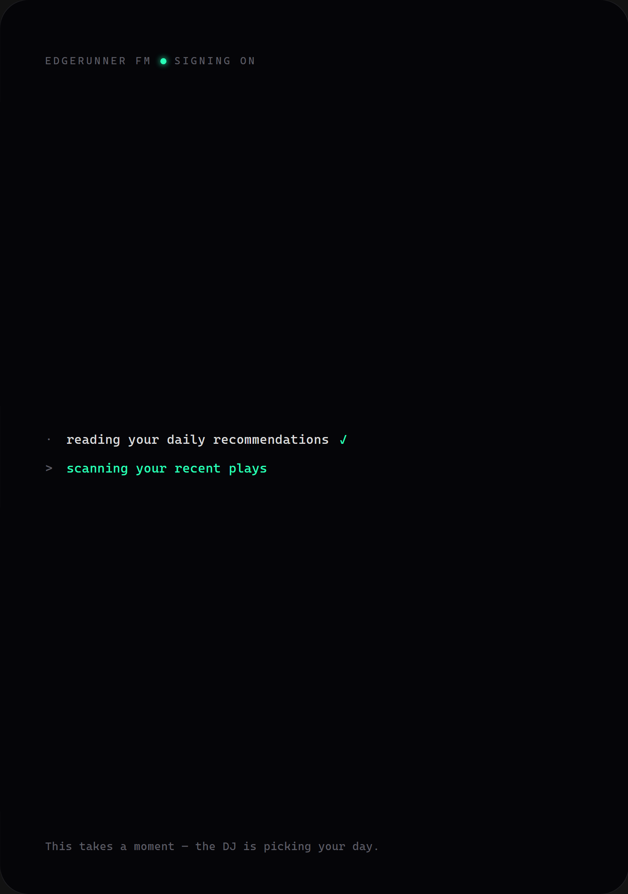
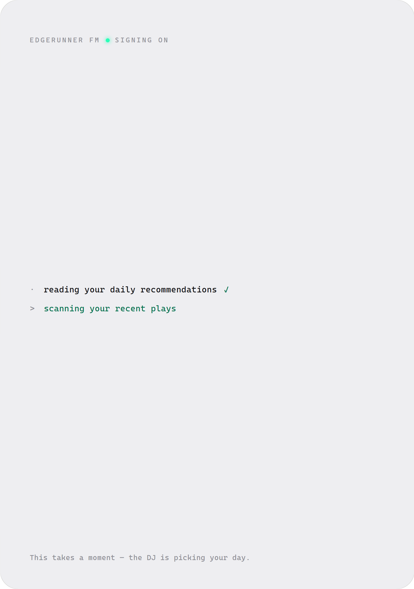

# 开发日志 · 2026-10-21

> 只记值得回看的事：踩到的坑、被推翻的判断、当时没想清楚的地方。流水账不写。

## 做了什么

1. 日表从日推来：同一套工具环，换一个终局工具（PR #56，ADR-0030）。
2. 真数据端到端：用真 cookie 跑一遍日推那条路，把「9 首里 1 首来自日推」这条缝记下来（PR #57，ADR-0030 追记）。
3. 版本推到 0.1.4：这一版才把「日推」和它的真数据验证一起装进 exe（PR #58）。
4. 池子优先：排表拆两段（第一段只给池子、第二段才放开搜索），曲风降级成氛围提示（PR #59，ADR-0031）。
5. 开机进度：窗口先出生、排表在界面里跑（PR #60，ADR-0032）。
6. 首次体验：没填 key 的开机也有一首歌和一段口播，随包发（PR #61，ADR-0033）。
7. 架构图与收口：给系统画一张**每个节点都能指回仓库行号**的图，顺手把仓库收干净（PR #63）。

## 39 · 日推终于进了日表 —— 一次「我以为要接新接口」的摸底

用户待办：「llm 可以根据网易云音乐的每日推荐歌单来生成歌单吗」。

**摸底先省掉了一次白干。** 我以为要去接 `/recommend/songs`，翻开 `netease.ts` 才发现
它**早就会打**那个接口 —— 但只在「没有场景词」时才走。而 `buildDayPlan` 每一格都带着
`genres + mood` 去要歌，于是每一格都落在搜索上。**接口一直在，进日表的那条路从来没被走过。**
题面因此从「接上游」变成「日表从哪儿取料、谁来挑」——这两个问题的答案，代码里一个字都没写。

### grill 定下的两件事，其中一件改了实现形状

- 日推是**候选池**，不是歌单本身：挑、排序、分配到三格由 LLM 做（Q1b / Q2）。
- 「能从日推，**也允许自己搜**」（Q5）。

第二句决定了形状。我原本打算一次裸 completion 就完事（像 `buildTasteFromLibrary` 那样：
读一批歌、写一段文本、落库），但「允许自己搜」意味着模型要**先搜一下再决定** ——
那不是一次 completion 能做到的事。于是这一轮复用 `ToolLoopBrain` 的工具环，只换一个终局工具。

### 改了什么

- `core/brain/index.ts`：循环抽成 `loop<T>()`，`think()` / `plan()` 是同一台机器的两个入口。
  `TOOLS` 一个字没动，另给一份 `PLAN_TOOLS`（`daily_recommend` + `search_tracks` +
  `recent_plays` + `emit_plan`）。`readPlan` 校验同源但宽松：不照搬 `MIN_TRACKS`，
  一格空着不算坏，多出来的块忽略。
- `core/plan.ts`：`buildDayPlan` 多了一个**可选**的 `curate`。没有它 = 原来那个逐格搜索；
  有它就先问它，**缺哪格补哪格**；它整轮失败也只是一次 `.catch(() => null)`。
- `core/prompt.ts`：多一个 `planPrompt`。**不是**把 `systemPrompt` 换几个字 ——
  那一段讲的是「开口说话」的规矩（每首歌一句、语气跟着曲风），排表时一句都不说，
  套上它只会让模型开始写口播。共用的只有「我现在知道什么」那一块。
- `core/radio.ts`：`planCurator` 把日表和大脑接上；没配 key 连这一轮都不发。

### 困难 · 那台机器的第一次「开膛」

工具环原来整个长在 `think()` 里。要让排表也走它，只有两条路：复制一份循环，
或者把它抽出来。复制看起来更安全（不动已有代码），但「每个 tool_call 都要有回音」
「最后一步强制定稿」「在模型说完了之前不接受任何结论」这三条**是这个产品的脾气**，
它们出现两次就等于迟早会分叉 —— 而分叉的那一次，坏的是「模型不再被逼着定稿」这种
平时看不见的地方。所以选了开膛：`think` 变薄、`loop<T>` 变通用、终局工具变成一个参数。

代价是必须逐字保持行为。做法是把校验裁决定义成一个 `Verdict<T>`，
错误消息、驳回文案、`toolChoice` 的时机一个都没改 —— 然后靠那 5 条已有测试把我按住。

### 验证

- 单测 101 → **113**。新增 `tests/core/plan.test.mjs`（6 条：给了就用 / 只给一格 /
  抛错 / 回 null / 没有 curator / 源不可达）；`brain.test.mjs` +5（工具集封闭 / happy /
  少给一格不许塌进前一格 / 编造 id 驳回 / 三格全空驳回）；`radio.test.mjs` +1。
- 集成里那条断言是这一轮的重点：**开机第一条音乐请求是 `/recommend/songs`，而且早于任何
  `/cloudsearch`**。日表是不是搜出来的，只有这样才证明得了。
- **真模型冒烟**（`tools/smoke-plan.mjs`：真 `deepseek-v4.1-flash-1017` + 30 首假候选池，
  走的是 `buildDayPlan` + `curate` 那条真实接线）：模型先调 `daily_recommend`、
  又调了一次 `recent_plays`，然后交了三格 —— morning 全是 acoustic/jazz，
  daytime 全是 indie-pop/electronic，late-night 全是 ambient/synthwave。28 秒，两次工具调用。

### 留给自己的一条

**先看它是不是已经有了，再看要不要建。** 「接一个日推接口」这个题面，一半的答案在代码里、
另一半在命名上：`recommend({})` 这个「空参数」的形状，谁都没写「这是日推」。
下次碰到「X 接了吗」，先把 X 的两头都打开看一眼 —— 尤其是那个**看起来不像 X** 的入口。

## 40 · 日推第一次拿到真账号的歌 —— 真数据一跑，数字比结论更有用

PR #56 的日推路径当时只有**合成**证据：假 fetch 把「第一条请求是 `/recommend/songs`」钉死了。
这一次按 #43 的老办法，用真 cookie + 内置服务 + 真模型把它跑了一遍。

### 改了什么

- `tools/smoke-plan.mjs` 多一个 `--live`：假候选池换成**真的**内置网易云服务。服务不是另起一份，
  而是走 `main/netease-service.ts` —— 验的就是「下载即用」那条路上真正会跑的那份代码。
  顺手把每个音乐源请求记下来（只记 URL，不记 cookie）：日表是不是搜出来的，只有这样才说得清。
- 用法：`npm run smoke:plan -- --live --cookie-file=<path> --key-file=<path> --base-url=... --model=...`

### 困难 1 · 我自己把参数写错了，然后去怀疑 key 文件

第一发写的是 `--key-file <path>`（空格），脚本回「没拿到 key」—— 看着像桌面那个 `apikey.txt` 坏了。
其实 `arg()` 只认 `--name=value`。**工具报的错不一定在说那件事**：这句真话背后的原因，
是参数根本没被认出来。先读一眼自己脚本的参数语法，比去翻 key 文件便宜得多。

### 困难 2 · 真数字和需求之间有一道缝

一轮排表的实测（2026-10-21，真 cookie / 真 `deepseek-v4.1-flash-1017`）：

- 音乐源请求 **12** 次：`/recommend/songs` **1** 次、`/cloudsearch` **11** 次。
- 工具调用 13 次、用时 36 秒（6 次请求预算内）。
- 日表 9 首里**只有 1 首**（小半 — 陈粒）来自日推。

需求（Q1 b）写的是「日推当候选池，LLM 挑、必要时自己搜」，提示词也确实两条都写了
（`PLAN_PERSONA` 的 "are the pool you draw from"、user 段的 "Start with `daily_recommend`"）。
但实测是**搜为主**。原因不在「提示词没写」，而在池子本身：30 首**没有按场景组织**的日推
（雨天 / 盛夏的果实 / 去北极忘记你 …），模型没法确信「acoustic + jazz 这一格池子里够用」，
于是每一格都去搜一遍来保证命中曲风 —— 它做的是**保险**，不是偷懒。

### 留给自己的一条

**合成证据证明接线，真数据证明分寸。** 假 fetch 能把「哪条请求先发」钉死，
但它回答不了「模型拿到 30 首混杂的日推之后会怎么做」。所以真数据这一步不该等收尾 ——
这一次它是**跑在 PR 之后的**，代价是「日推当候选池」到底成没成立，我是靠一次事后验证才敢说的。

## 41 · 版本推到 0.1.4 —— 这一版把「日推」和它的验证一起收进去

- `package.json` 0.1.3 → 0.1.4（Release 流水线按 tag 出包）。
- README 进展表补上 #54..#57：内置音乐源、口播归位、日表从日推来、真数据端到端。

`v0.1.3` 之后落地了四件事，其中三件改了**开机之后会发生什么**：音乐源由内核代管启动、
口播变成一首歌一条、日表从日推里挑。所以这一版的 exe 才是第一个「完整流程」的 exe ——
上一版打的包，装的是这四件事之前的样子。

仍然出成 **draft**：要人看过 `gh release edit v0.1.4 --draft=false` 才放出去（5.3 的规矩没变）。

**没跟着修的两条**（都在这一版的验证里露出来，但都不该顺手改）：
开机要等排表那一轮（实测 36s 才开口）；以及「日推当候选池」目前只成立一半。
两条都记在 ADR-0030 的追记里。

### 顺带修掉一条「假绿」的测试

这一版的 CI 门禁红了一次，红在 `tests/main/netease-service.test.mjs` 的「stop() 之后端口松开」——
**断言和它自己的文案是反的**：`occupied()` 的语义是「这个端口有人占着」，
而那条循环在等它变成「有人占着」、断言也 expect `true`。它只在本机（kill 之后端口还挂着几百毫秒）
才「通过」；CI 上子进程死得快，就露了馅。改成「等它松开 + 断言松开」——
这不只是让 CI 变绿，是让这条测试终于开始说它本来要说的那句话。
## 42 · 池子优先 —— 把「先挑日推」从叮嘱改成编排

上一次真数据跑完留下的缝：9 首日表里只有 1 首来自日推。这一轮不是再写一句更狠的提示词
（`PLAN_PERSONA` 和 user 段早就写了「池子」），而是**把工具集拆开**：第一段只给池子（没有搜索），
代码数出没填满的格，第二段才对那几格放开搜索（ADR-0031）。

改完再跑真数据：**9 首全来自日推，音乐源请求从 12 次变成 1 次，工具调用从 13 次变成 2 次。**
「每格 3 首」从提示词里的硬配额收成 `PLAN_PER_BLOCK` 一个常量；曲风在提示词里降级成
「氛围提示，不是过滤器」（`BLOCKS.genres` 一个字段没删，它仍然只服务搜索兜底）。

**但门槛没全过。** 事前定的三条（日推 ≥6 / 请求 ≤4 / 用时 ≤20s）里，前两条 3 次全过，
**用时只过了 1 次**（28 / 22 / 14s，热身那次 20s）。用时是这一轮的全部，几乎全是模型延迟 ——
工具调用只剩 2 次，能压的已经压完。

**没降门槛。** 按事前定的规矩：三次数字如实记，这一轮照合。
门槛是给人看的，不是给数字让路的。

**第二段最容易写错的地方**：`readPlan` 必须按「这一段自己的格号」索引，再把结果映射回原来的槽位 ——
否则补上的 id 会进错格。这条现在有测试盯着（`排日表：池子没填满的格，第二段只带那一格…`）。

## 43 · 开机进度 —— 缝不在进度条，在「窗口还没出生」

需求是「排表可以做个 cli 界面显示进度，排完之后再进开场口播」。动手前的摸底把这一轮的方向改了。

**真正的问题不是「进度看不见」，是「连窗口都还没出生」。** `main/bootstrap.ts` 的 `startRadio` await 完
`radio.boot()` 才 return，`main/main.ts` 拿到返回值才 `new BrowserWindow` —— 排表那 14–28s 里，
屏幕上没有这个应用。所以第一刀砍在时序：窗口先出生，`boot()` 交给 `main.ts` 在 `loadURL` 之后发起、
**不 await**。这是本轮唯一的意外，也是唯一值得记的一条：**用户说的「加个进度界面」，底下藏着「窗口根本没出生」。**

第二刀是「进度长什么样」。工具环报的是工具名（`search_tracks`），界面要说人话（`deep-search`）；中间加了一张
五个 id 的映射表（`bootStepOf`），把「什么时候做了什么」从「用什么工具做的」里摘出来。

**进度做成累积快照，不是增量日志。** 一条 payload 带「到目前出现过的全部步骤」，去重、有序。晚连上来的窗口
补收一条就对齐了 —— 不需要重放，不需要问「我漏了第几条」。快照订阅里也补推一条 `running`，
于是「窗口刚出生」和「中途重连」走的是同一条路。

**两条结束条件，界面永远不许挂住**：第一句 `say` 出声，或者 `boot()` 收尾（没 key / 失败）。
只盖 `boot()` 这一段 —— 那十几秒「排完表还在等开口」的空白（ADR-0030 追记）也在里面，
所以进度是盖到**开场口播真的出声**为止，不是排完表就消失。

**不闪一下让人反应不过来**：最短展示 0.8s + 完成态停留 0.6s + 淡出 0.32s（三档常量写在 `BootProgress.tsx` 顶部）。
mock 用既有控制通道回放（`{ boot: true }`，每步 1.5s），不给默认流程加时序风险；契约测试补了一条 `progress`
事件的结构断言（累积、有序、以 `done` 收尾）。

界面证据（dark / light）：

## 44 · 首次体验 —— 内容不难，难的是「不许污染他的电台」

用户要的是「别人没填 key 的时候别看见黑屏」。动手才发现这一轮的工作量不在内容（一首歌 + 一段话），
全在**边界**：这一段东西必须和用户自己的电台互不干涉。三处边界，一处比一处隐蔽。

**嗓子。** demo 的口播必须**不依赖任何 key**，所以它不能走用户配的那个 provider（他配的可能正是 fish）。
解法是把「一段已经合成好的音频」本身当成一个 provider（`createFileTts`），它故意忽略 `req.voice`：
这份音频就是这一个音色，参数改不动它。

**缓存。** 两套引擎（用户的、文件的）共用同一个 `data/cache`。ADR-0008 那条老性质在这里救了我们：
内容寻址的键里带着 providerId，`<hash>.<ext>` 也就不会撞 —— 同一句话 + 同一把嗓子 = 同一份文件，
两套引擎各认各的。

**身份。** 「找那首歌」不能拼 id。id 怎么编号是本地源自己的事（ADR-0014 分工），拼出来就是越界；
走 `music.library()` 按文件名认，才和「本地源认 `Artist - Title.mp3`」这件事同源。

**冒烟脚本当场逮到我自己一个错**：脚本从 `audioUrl` 里取 key 时把 `.wav` 后缀一起带上了，`ttsAudio(key)` 于是返回 null。
这不是产品 bug —— 但**恰恰是这脚本存在的理由**：它验的是「服务端发出去的那串字节 = 随包那份 wav」，
不是我「看了一眼代码觉得对」。（顺带记下 server 那条取法：`/tts/<key>.<ext>` 里的 key **不带后缀**，见 `core/server.ts` 的 `TTS_PATH`。）

**一条文档被我自己改了。** 需求文档原先写「不进 taste、不进日表」，动手时发现代码里根本没有黑名单 ——
真实机制是降级链的顺序（`firstNonEmpty`：有 cookie 时画像读的是他的网易云歌单，随包那一首在本地目录里，不在那一份里）。
于是把文档改成说清机制，而不是顺手加一个没人要的黑名单：**文档不许比代码漂亮。**

## 45 · 架构图 —— 一张能被核对的图，而不是一张好看的画

这一轮不加功能：把仓库收干净，给系统画一张图。图的规矩是 archify 定的 —— **每个节点都要指回仓库里的行号**，
钉在一个具体提交上（`candidate.json` 里写着 40 位哈希）。所以它不是示意图，是一串可以被逐条核对的断言。
第一次跑就四个门全过（含真实浏览器门），**没有一行靠我说了算**。

**第一个决定：画到哪一层。** 把 `core/` 的角色全摊开会有 20 多个节点、线互相穿，读者要先读三遍才知道从哪看起。
于是按「读者要问什么」重收一层：`plan` / `taste` 归进 `Radio 内核`，`core/providers/` 只留**三条真正出网的路**
（LLM / 音乐 / 嗓子）。被砍掉的事实写进图下的要点卡 —— **省略不等于消失**。

**第二个决定：边界框里装什么。** 「你的 Windows 电脑」这个框只能装**进程内**的东西，`你` / `LLM API` / `网易云音乐` 必须在框外。
这一条直接决定了两个子进程的归属：`piper.exe` 与内置网易云服务是被 spawn 的独立进程，却画在框内 ——
因为对读者来说「双击 exe 就能用」才是那个事实，而它们正是那个事实的代价。

**哑掉的一次：想顺手做一张静态 SVG 塞进 README。** 从 HTML 里抠 `<svg>` 看着可行，抠出来颜色全丢 ——
它的 CSS 用的是**页面级变量**（`var(--frontend-stroke)`），SVG 自己不带那套变量。
回头走 archify 自己的抓图（`visual-check`），拿到深浅两张 1440 / 2048 的 PNG。
**能验证的路径优先于看起来更优雅的路径。**

**又一回「先量一把再说话」。** 追加要求是「这首歌的口播就用现在的声音生成一份，固定下来」。
那份随包的 `assets/demo/sign-of-the-times.wav` 到底是不是现在这把嗓子？piper 是**非确定性**的（同一句话两次合成，字节都不一样），
所以比哈希没用。改量基频：随包 **96.7 Hz**、`en_GB-alan-medium` **95.9 Hz**、`en_GB-ryan-high` **132.8 Hz** ——
它在 3 Hz 以内，**是 alan，不是旧的 ryan**。（顺手确认 DB 的 prefs 里没有 `tts.*`，走的就是出厂默认。）
结论：不需要重新合成，它已经「固定」在出厂嗓上了。

## 46 · 收尾清点：把「文档说了、仓库没有」再对一遍

架构图画完，回头把仓库整个过了一遍：哪些文件没人引用、哪些文档点了不存在的路径。

**三处点错了文件。** `shared/ports.ts` 的注释、`docs/abstraction-layer.md`、ADR-0014 都写着
「`shared/tsconfig.json` 是 `lib: ES2022` + `types: []`」—— 可 `shared/` 下**根本没有** tsconfig：
那份配置是**根** `tsconfig.json`（`include: ["shared"]`）。设置没写错，文件名点错了，一并改成真路径。

**五张截图在仓库里没人引用。** `boot-dark/light.png`（第 43 条的证据）与 `5.4-*.png`（第 22 条的证据）
此前只出现在 PR 正文里；补回引用，让每一张 committed 的图都能从文档里点开 —— 不留孤儿，也不删证据。

**demo 口播「是不是现在这把嗓子」，用基频再确认一次。** 逐字节对不上任何一次新合成，
因为 piper 是**非确定性**的（同输入两次结果都不同，见第 45 条）——比字节没用。比基频：随包 96 Hz，
`en_GB-alan-medium` 97 Hz，在同一条噪声带里；旧的 `en_US-ryan-high` 是 138 Hz。**是现在这把，不用重合成。**

## 47 · 版本推到 0.1.5 —— 把「首次体验 / 开机进度 / 池子优先 / 架构图」一起切出来

`v0.1.4` 切出来的那一刻（#58），后面这六轮还没发生：#59 池子优先、#60 开机进度、#61 首次体验、
#62/#63 文档与架构图、#64 收尾清点。而 tag 指向提交 —— `v0.1.4` 钉在 #58 上，所以它那份 draft 里的
exe **不含 demo**。这不是打包出错，是 tag 本来就在那儿。

**为什么不干脆改 0.1.4 那个 draft**：往回推 tag 没有意义；而且第 23 条留下的规矩是「本地能打出来
不等于 CI 能，发布一律走 tag」。所以照老办法切一版新的：`package.json` 0.1.4 → 0.1.5，roadmap 补 6.24，
README 的进展表补上架构图那一行。

**发布仍然留给人**：流水线照旧只出 **draft**（`gh release edit v0.1.5 --draft=false` 才放出去）。
当前对公众可见的版本是 **v0.1.1** —— 它比现在这套少了「首次体验」，而 README 恰恰在讲这一节。
放不放、什么时候放，是一个「人看过」的动作，不归流水线。

## 48 · 「我打开是这样」：包里没有音乐，而报错说是 key 不对

用户实测 `v0.1.5` 便携版，截图是这样：界面正常、时钟在走、引导横幅在、`0 TRACKS`，
聊天区两条 `NO_LLM_KEY: upstream returned HTTP 401`。查下来是**两个毛病叠在一起，第二个把第一个盖住了**（ADR-0034）。

**① 包里根本没有内置的音乐源。** `resources\netease\` 只有两个 json，源目录是 2849 个文件 / 27 MB。
`main/main.ts:49` 的 `existsSync(neteaseEntry(dir))` 因此为假 → 内置服务没被拉起 → `neteaseBaseUrl` 是
`undefined` → 静默落回 `http://127.0.0.1:3000`（ADR-0016 留给「用户自己起一个」的那条路）→ 队列空。

**为什么之前没发现**：这一路失败是**静默**的 —— exe 打得出来、CI 从边界检查到测试全绿、界面正常渲染。
昨天那 9 次播放和那份真日表是**开发态**跑出来的（开发态读 `vendor/netease`，那份是完整的）。换句话说，
**发出去的每一个便携版都缺这一环**，只是没有人在打包产物上双击过。

**② 那条 401 是大脑报的。** 音乐链把源的错误收成空结果（`core/music/index.ts` 的 `firstNonEmpty`），
所以 `HttpError` 只能从 LLM 那一路出来。用 prefs 里那把 key 做两件事，一次说清：打到 **DashScope 默认域名**
→ `401 Incorrect API key provided`（上游原话）；打到 prefs 里那个 `token-plan.cn-beijing.maas.aliyuncs.com`
→ **200，真回答**。用户那把 `sk-sp-…` 只认后者，所以那一刻 `llm.baseUrl` 还是默认值。
而 `llmFailureCode` 把 401 翻成 `NO_LLM_KEY`（ADR-0027 定的），界面又给 `NO_LLM_KEY` 画「补 key」的引导横幅
—— **「包里没有音乐」于是看起来像「你没填 key」**。这也是这条查得慢的原因：上游原话被丢掉了，
而它是唯一能指路的东西。

**改了什么**：`electron-builder.yml` 把 `vendor/netease/node_modules` 单独再搬一条
（extraResources 会无条件吞掉源目录**顶层**的 `node_modules`，写 filter 也救不回来）；
CI 加一条落点自检，让这种包发不出去；`core/radio.ts` 新增 `describeHttp`，把上游那句话压成一行、
截断 200 字跟在状态码后面（只带响应体，不带请求 —— 请求里有 key）。

**验证不是「跑一遍没报错」**，是四条对得上：

| 验什么 | 结果 |
|---|---|
| 落点文件数 | 落点 **2849** = `vendor/netease` 2849（改之前是 **2**） |
| 是不是同一份字节 | `app.js` sha256 前 16 位两边都是 `476716a876daaf85` |
| 打包后的字节真能起 | 用落点里的 `app.js` spawn：它自己打印 `server running @ http://localhost:39123` |
| 真 cookie 拿得到真日推 | `tools/smoke-plan.mjs --live`：`/recommend/songs` → 真 id，模型交回完整日表 |

**留给人做的一件事**：界面仍把「上游拒绝这把 key」画成「补 key」的引导横幅。上游原话现在可见了，
措辞这一层记进 roadmap，不当场改 —— 它动的是渲染层的文案与分支，值得单独一轮。

## 49 · 现场日志：双击之后出了什么事，事后要能读出来（ADR-0035）

用户的原话是「你做一个方便你查问题的日志功能」。触发点是第 48 条：那次「我打开是这样」，
真正花时间的不是修，是**重建现场** —— 数落点里的文件、把 prefs 从 sqlite 里读出来、再拿同一把 key
分别打两个域名。三件事本该看一眼日志就完，而当时唯一能留话的地方（`console.warn`）在便携版里
通到**没有人的地方**：双击启动，没有终端。

**一句话说清做了什么**：`%APPDATA%\EdgeRunner\logs\edgerunner.log`，一行一条
`<ISO 时间>  <区域>  <正文>`，区域是 `boot / http / error / warn / music` 五个词；1 MB 轮转，只留一代。

**为什么 `core/` 一个字没改**：`core/` 的每一次出网都经过**同一个**端口 `HttpFetch`（大脑 / 音乐源 /
TTS 三条路），所以在 `main/` 把它包一层就等于全记上。而且「日志放哪、留多久」本来就是宿主的决定 ——
`core/` 继续只用它的 `warn` 说话，一行都不动。

**去敏不靠猜 key 的形状**：请求头**一律不记**（key 和 cookie 都在头里，不记头就没有它们）；
URL 里已知名的 query 值换成 `<redacted>`；设置摘要只记「set / 空」，连长度都不记。这是结构性保证，
不是「看起来像 key 就过滤」—— 那把网易云 cookie 就不像任何 key 的形状。自检里专门有一条把 key
放进请求头，断言日志行里**搜不到它**。

**踩到的一处**（这一版最容易踩回去的）：要把上游原话记下来，就得读一次 `response.text()`，
而 body 只能读一次。把原来的对象还回去，`core/` 那边 `HttpError.detail` 一读就撞 `Body is unusable` ——
上游那句好好的 `Incorrect API key provided` 会被换成一个 `TypeError`，等于当场把 ADR-0034 刚修好的
那件事又弄坏一次。所以包一层之后要把响应 **重建**一份再交出去，最后一条测试钉的就是它。

**顺手补的一件事**：内置服务（ADR-0028）**跑着跑着死掉**原来是静默的 —— 只有「启动失败」会 warn。
现在进程一退就带一句，连子进程自己的最后三行。这正落在「刚才还有歌、现在没了」那类现场上。

**验证**：

| 验什么 | 结果 |
|---|---|
| 新增自检 | `tests/main/log.test.mjs` **9 条**：去敏 / 压行 / 轮转 / 写不进去不抛 / 2xx 不含 key / 非 2xx 还能再读 |
| 全量测试 | **131 passed**（改之前 122） |
| 边界检查 | `npm run boundaries` 通过（`main/` 6 个文件） |
| 类型与构建 | `npm run typecheck` + `npm run build` 通过 |

**没做**（都写在需求文档第 4 节的假设表里）：不记请求体、不做等级开关、不在界面上看日志、
不暴露成 HTTP 接口。「要在界面里看日志」是另一件事，值得单独一轮。

## 50 · 用户实测之后的六条：四条「看着配好了、其实没跑」

用户拿着 0.1.7 的便携版实测，回来六条。查完发现四条是同一类毛病：**界面说的，和电台实际做的，不是一回事。**

**先读日志，别猜。** 第 49 条刚把现场日志装上，这一轮第一次真的用它 —— 四次开机的记录全在，一次筛选就把三条反馈各归各位：

| 日志里的事实 | 它证明了什么 |
|---|---|
| `tts fish en_GB-alan-medium key=EMPTY` + `TTS_FAILED TTS 合成失败：fetch failed` | 反馈①的后半：`ttsProviderFor` 只看「选了 fish」，不看有没有 key —— 每一次合成都在打一个不会回话的端点 |
| `cloudsearch` 22 次、`/recommend/songs` **0** 次、`daily-pool` 步骤 **0** 次 | 排表那一轮的池子优先（ADR-0031）在真实运行里没被走过 —— 记成待办，这一轮不查到底 |
| `taste` **0** 次（且 `%APPDATA%\EdgeRunner\taste\` 目录不存在） | 反馈⑤的答案：**没走**。口味画像那条路一次都没跑过 |
| `POST .../chat/completions → 401 Incorrect API key provided` 4 次，域名是 `dashscope` | 用户那把 `sk-sp-…` 只认 `token-plan.cn-beijing.maas.aliyuncs.com`。后两次开机他自己换了域名，然后一路 200 |

**「放歌的时候没有口播」是两件事，第二件的取证走过一段弯路。**

第一件好找：`holdIntros` 挂起来的那几句只有**自然放完**（`advance()`）才推。点队列切歌、点上一首
走的是 `POST /api/playback { event: 'started' }` —— 那条路原来一个字都不说。点一首歌，它就该报它的名字。
改法是让 `speakHeld(id)` 成为唯一的出口，两条路都走它；同一首只说得出口一次（说出去就从 `heldSay` 里删掉）。

第二件差点改错东西。日志里那行 `tts fish … key=EMPTY` 看着像「prefs 里存了 fish」，
可我**复现不出来**：复制一份用户的 `edgerunner.sqlite`（只读），用真的 `createRadio` 跑
`radio.settings()`，回来的是 `provider: piper` —— prefs 表里**没有** `tts.provider` 这一行。
差一点因此去写一个「迁移」，去修一个**不存在**的状态。

把两边对齐才看明白：我读的是沙箱里被重定向过的那一份库，日志里的那一份才是真的。
**日志 > 我对库的推测**，因为它就是那台机器上那一次运行写的。

这一段的结论有两条，第二条比第一条有用：

1. 不在 prefs 上做判断、不写迁移 —— 「没 key 就回落 piper」这条修完，那种状态自己就对了。
2. **「我复现不出来」本身是一个结论，不是一句可以跳过的话。** 差一点就去改了一个不存在的东西。

**「真的走了读曲库 → 生成 taste.md 的流程吗」—— 没走，而且原因特别小。**
`learnTaste()` 的触发条件是 `!hadCookie && cookie !== ''`（cookie **从无到有**）。
cookie 早就填过的人，这个条件永远不成立 —— 于是 ADR-0025 那个决策的实现，
**除了第一次填 cookie 的那一刻，对所有人都是没生效的**。`%APPDATA%\EdgeRunner\taste\` 不存在，
是它一次都没跑过的直接证据。

改法是换触发点，不是换决策：`boot()` 在排表之前先 `await learnTaste()`，`saveSettings` 里
无条件补一次（已经有一份时读一眼文件名就回来，重复调用是便宜的）。ADR-0025 一个字没改。
这一条**故意没新开 ADR** —— 决策没变，变的是「什么时候去问它」；新开一份就是拿文档跟 ADR-0025 打架。

**模型名要手打。** 加了 `POST /api/models`：服务端打 `GET {baseUrl}/models`，去重、排序、交给界面，
界面灌进 `<datalist>` —— 既能挑也能打。实测那个端点：`token-plan.cn-beijing.maas.aliyuncs.com`
的 `/compatible-mode/v1/models` 回 200，认识 `qwen3.7-max` / `deepseek-v4-pro` / `glm-5.2` 一票模型。
key 缺省借库里那把、现填的优先 —— 用户填完 key 还没保存就该看见下拉框。

**「手搓的播放器不太好用」——这一条我改了它的形状，没照字面做。**
字面是「嵌一个开源播放器进来」，但这一档的硬要求是视觉 1:1 复刻（口播界面那张 616×876 的卡片是基准）。
嵌一个别人的皮肤，当场就把这条要求破坏了。所以拆成两件事：**引擎**换 Howler
（`html5: true` —— `/api/audio` 是 302 到远端 CDN，那家不给 CORS 头，Web Audio 那条路取不到音频）；
**手感**把运输条从 3px 的 `
` 换成真的 `<button>`，点与拖都跳到那一刻，
命中区用伪元素上下各撑 9px —— **视觉一点不变，可点区域从 3px 变 21px**。
「不太好用」的账就是这么算的：一半在引擎（自己管换源、自己接 `timeupdate`），一半在那条点不动的进度条。

**口播变长，而且是两处一起改。** 长度约束写在 `core/prompt.ts` 与 `core/brain/index.ts` 两个地方，
一起改成「Two or three sentences, 40-55 words — that is 15-20 seconds spoken」。
两处不一致时，模型会同时收到两条互相矛盾的长度约束 —— 为一个文案加一条断言
（`tests/core/prompt.test.mjs` 最后一条）比记住「改一处要改两处」便宜。

**验证**：

| 验什么 | 结果 |
|---|---|
| 新增自检 | **6 条**：嗓子回落 / 点队列切歌也开口播 / 模型目录去重排序 / 开机补口味画像 / `POST /api/models` 契约 / 口播长度两处一致 |
| 全量测试 | **137 passed**（改之前 131） |
| 边界检查 | `npm run boundaries` 通过（`renderer/` 18 个文件，howler 只进渲染进程，边界不变） |
| 类型与构建 | `npm run typecheck` + `npm run build` 通过 |

**没做**：池子优先在真实运行里没被走过这件事只记成待办 —— 要查的是「真实模型为什么跳过
`daily_recommend` 直接去搜」，那是 LLM transcript 层面的事，不是日志层面的事。